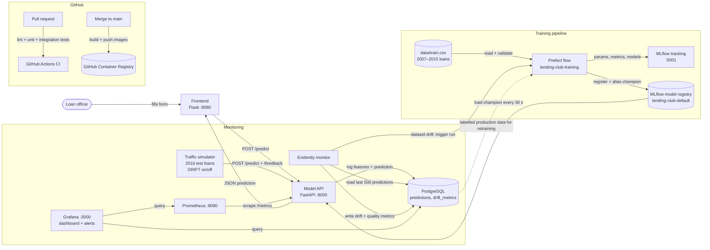
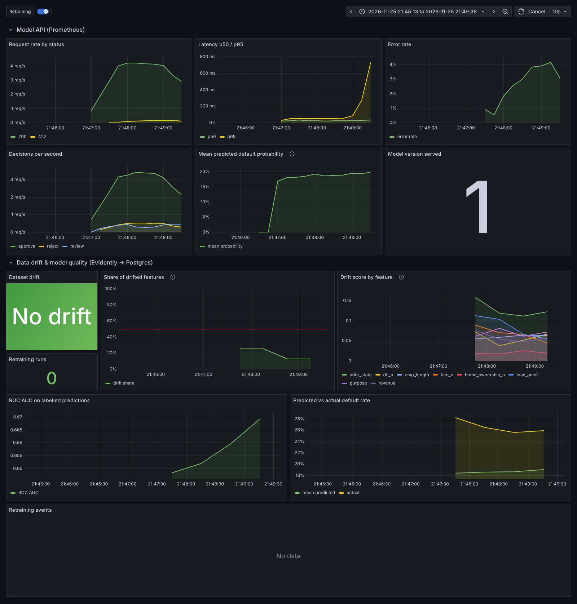
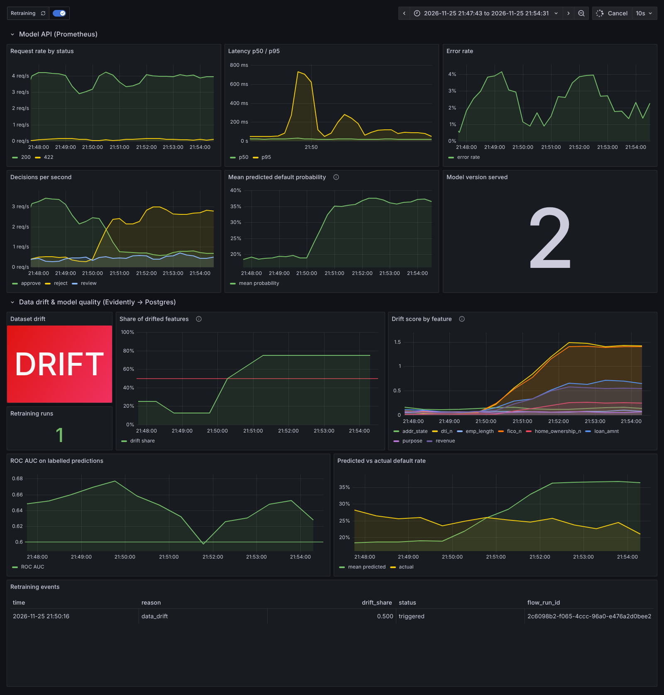
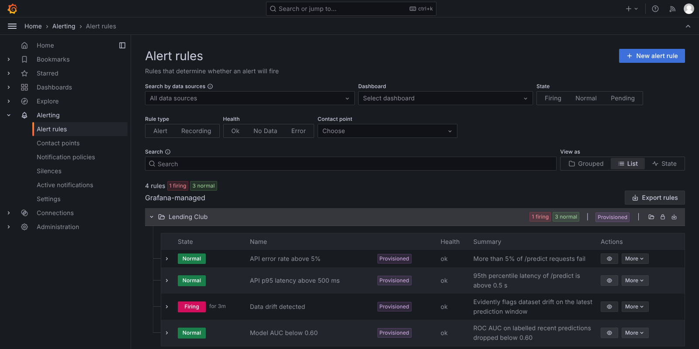
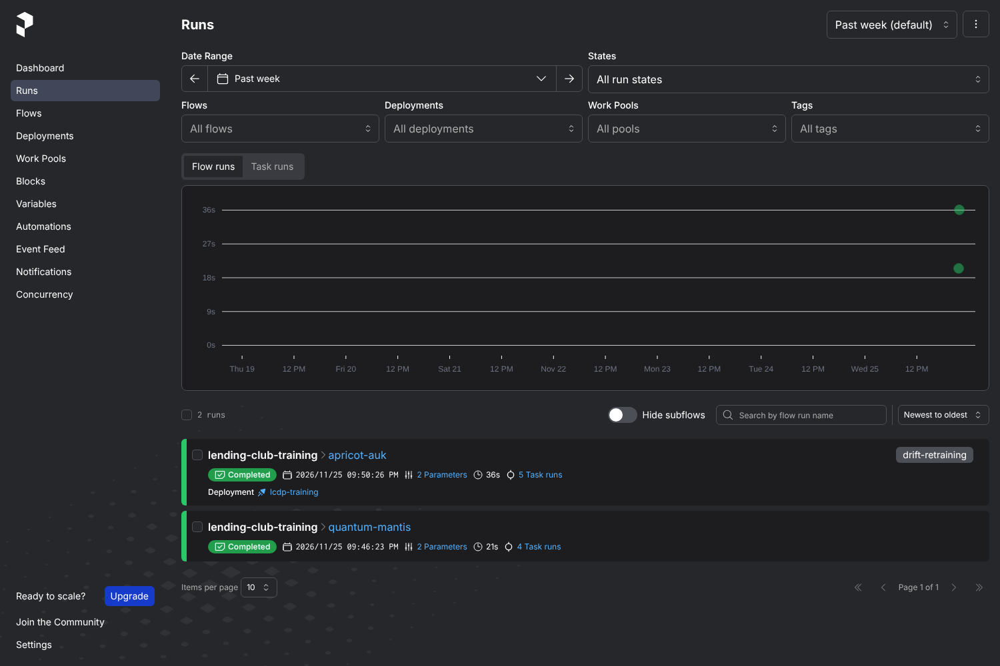
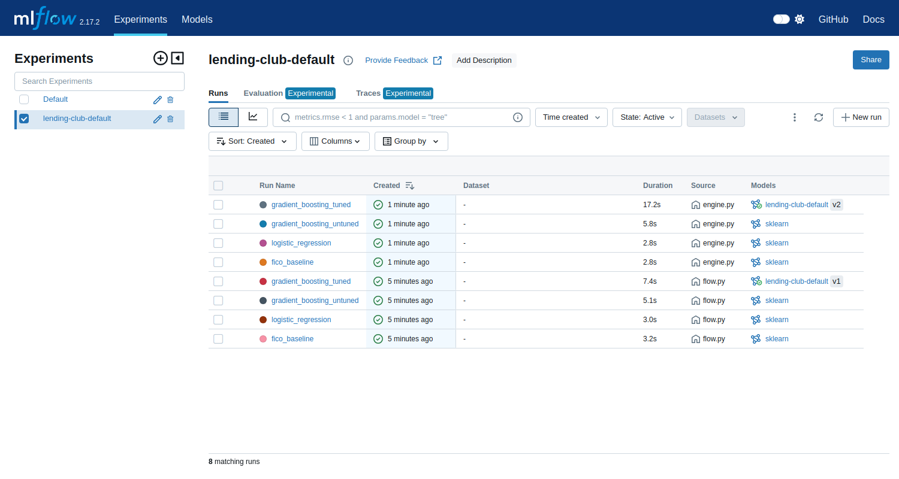
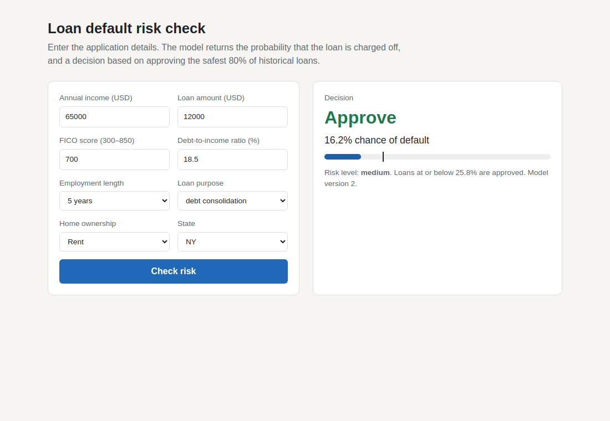
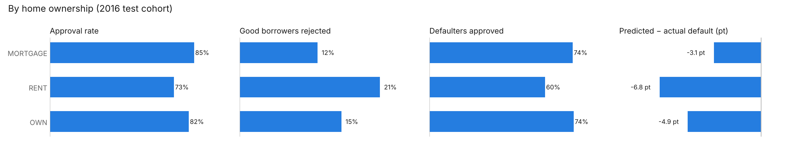

# Lending Club Loan Default Prediction: an end-to-end ML system

**Course:** INSY 684 (builds on our INSY 674 project) · **Team:** Group 6 · **Repository:** `lending-club-default-prediction`

| Member | GitHub | Owns |
|---|---|---|
| Una Qian | [@o-tunamonana](https://github.com/o-tunamonana) | Repo structure, Prefect training flow, docker-compose, CI/CD |
| Nat Suriyapanuwat | [@ntnatts](https://github.com/ntnatts) | Model candidates, MLflow tracking and registry |
| Bingqiang Zhao | [@ebisushi](https://github.com/ebisushi) | Model API (FastAPI), Prometheus metrics, prediction logging |
| Sirui Chen | [@irischensr](https://github.com/irischensr) | Traffic simulator, Evidently drift monitoring, Grafana dashboard and alerts |
| Dora Zhuang | [@Doraaadorable](https://github.com/Doraaadorable) | Frontend, architecture diagram, README, fairness check |

## 1. Problem

A lender wants to approve enough loans to keep volume up while limiting defaults. We score each
application with the probability that it will be **charged off**, and approve the safest 80% of loans,
a policy chosen in INSY 674. On the 2016 test cohort, the tuned gradient boosting model kept the
default rate among approved loans at **19.5%**, against **21.6%** when ranking by FICO alone
(full analysis: [docs/model_development.md](docs/model_development.md)).

INSY 684 turns that notebook work into a running system: an orchestrated training pipeline, tracked
experiments, a registered model served behind an API and a web form, and monitoring that detects
data drift and retrains the model automatically.

- **Task:** binary classification, one row per loan, target `Default` (1 = charged off).
- **Inputs at prediction time:** income, DTI, loan amount, FICO, employment length, purpose, home ownership, state.
- **Training data:** 150,000 loans issued 2007–2015. **Unseen traffic:** 50,000 loans issued in 2016.

## 2. Architecture



The diagram source is also kept in [docs/architecture.mmd](docs/architecture.mmd).

**A user's request:** the loan officer submits the form → the frontend container sends
`POST /predict` to the API container → the API validates the input, scores it with the champion
model loaded from the MLflow registry, logs the prediction to PostgreSQL and returns the probability,
risk level and decision → the frontend shows the result.

## 3. Run it locally

Requirements: Docker Desktop (with Compose v2) and about 4 GB of free memory.

```bash
git clone https://github.com/o-tunamonana/lending-club-default-prediction.git
cd lending-club-default-prediction
cp .env.example .env            # then change the passwords in .env
docker compose up --build -d    # first build takes ~5 minutes
```

On the first start the training container finds no registered model, runs the Prefect flow once
(about 30 s), registers the best model and keeps serving the flow for retraining. The API loads the
model as soon as it is registered and the simulator starts sending traffic.

| Service | URL |
|---|---|
| Frontend (loan form) | http://localhost:8080 |
| Model API docs | http://localhost:8000/docs |
| MLflow | http://localhost:5001 |
| Prefect | http://localhost:4200 |
| Prometheus | http://localhost:9090 |
| Grafana (admin / password from `.env`) | http://localhost:3000 → Dashboards → Lending Club Model Monitoring |

**Inject drift** (riskier applicants: lower FICO and income, higher DTI and loan amounts, more renters):

```bash
DRIFT=true docker compose up -d simulator     # switch to drifted traffic
docker compose up -d simulator                # back to normal traffic
```

**Trigger a training run manually:** Prefect UI → Deployments → `lcdp-training` → Run, or
`docker compose exec training prefect deployment run lending-club-training/lcdp-training`.

**Stop:** `docker compose down` (keeps data) or `docker compose down -v` (also deletes the
database, MLflow runs and the model registry).

**Run the tests locally** (Python 3.11):

```bash
pip install -r requirements-dev.txt
ruff check .
pytest                                   # unit tests
API_URL=http://localhost:8000 pytest -m integration   # needs the API running
```

## 4. Tools

| Tool | What it does here | Where |
|---|---|---|
| **docker-compose** | Starts all 10 services with one command; `docker compose down` stops them | `docker-compose.yml` |
| **Prefect** | Runs training as a flow: load → validate → train → register. Served as a deployment so the monitor can trigger it | `training/flow.py` |
| **MLflow** | Logs every candidate (FICO baseline, logistic regression, untuned and tuned gradient boosting) with parameters, ROC AUC, average precision, Brier score and approval-policy metrics. The best model is registered as `lending-club-default` with alias `champion` | `src/lcdp/train.py` |
| **FastAPI** | Model API: `/predict`, `/feedback`, `/health`, `/metrics`. Pydantic rejects bad input with a 422. Hot-swaps the model when the `champion` alias moves | `api/` |
| **Flask** | Frontend form that calls the API and shows the decision; handles invalid input and API outages | `frontend/` |
| **Traffic simulator** | Python script that replays unseen 2016 loans, sends their real outcomes to `/feedback`, adds 2% invalid requests, and injects drift with `DRIFT=true` | `monitoring/simulate.py` |
| **Evidently** | Every 30 s compares the last 500 predictions with the 2015 training cohort (`DataDriftPreset`) and scores labelled predictions (`ClassificationQualityMetric`) | `monitoring/monitor.py`, `src/lcdp/drift.py` |
| **PostgreSQL** | Stores predictions, feedback labels, Evidently results and retraining events | `db/init.sql` |
| **Prometheus** | Scrapes the API's `/metrics`: request count, latency histogram, errors, decisions, predicted probabilities, model version | `monitoring/prometheus/` |
| **Grafana** | Dashboard (request rate, latency, error rate, prediction drift, data drift, AUC) and four alert rules, all provisioned as code | `monitoring/grafana/` |
| **GitHub Actions** | CI on every PR: ruff, unit tests, then an integration test against the built API container. CD on merge to main: builds the four images and pushes them to GHCR | `.github/workflows/` |

**Retraining rule:** when Evidently reports dataset drift (at least half of the inputs drifted),
the monitor starts the Prefect deployment with `reason=drift`. The flow retrains on the training data
plus production predictions whose outcome is known, registers a new version and moves the
`champion` alias. It retrains at most once per drift episode (until a window without drift is seen), so sustained drift does not retrain every cycle; failed triggers are retried on the next cycle.

## 5. Monitoring: normal traffic vs. drift

**Normal traffic** (2016 loans as they are): no dataset drift (12–25% of inputs drift slightly, mostly
income and state), mean predicted default probability about 19%, ROC AUC about 0.65, model version 1.



**After injecting drift:** the share of drifted inputs jumps to 75% (FICO, income, DTI, loan amount,
home ownership), the dataset-drift panel turns red, the mean predicted probability rises from 19% to
37% and most decisions become rejections. The monitor triggers retraining (orange line) and the API
switches to model version 2 without restarting.



The **Data drift detected** alert fires:



Retraining run in Prefect (tagged `drift-retraining`) and both model versions in MLflow:




## 6. Frontend



## 7. Fairness check

We compared approvals and errors across home ownership and the 12 largest states on the 2016
cohort ([docs/fairness.md](docs/fairness.md), script `scripts/fairness_analysis.py`). Every group's
approval rate is at least 0.86 of the highest group's (above the four-fifths rule), and the gaps
mostly follow real differences in default rates. Errors are less even: renters who would repay are
rejected 21% of the time vs 12% for mortgage holders, and the model under-predicts risk most for
renters.



## 8. Tests

| File | What it checks |
|---|---|
| `tests/test_data_validation.py` | Required columns, missing or non-binary target, duplicate ids, unknown categories |
| `tests/test_preprocessing.py` | A known input gives the expected features (loan-to-income, DTI placeholder, employment years); no missing values after the pipeline; unseen categories |
| `tests/test_model.py` | The model beats the FICO baseline and a naive constant prediction; the 80% approval policy lowers the default rate |
| `tests/test_predictions.py` | Probabilities are in [0, 1]; higher FICO lowers risk; lower income raises risk |
| `tests/test_drift.py` | Same-period data is not flagged; injected drift is flagged and triggers retraining; once per drift episode; cutoff from the API |
| `tests/test_api.py` | Valid requests, decision thresholds, bad input → 422, no model → 503, `/metrics` |
| `tests/integration/test_api_container.py` | Starts the API container and sends it real HTTP requests |

## 9. Repository layout

```text
src/lcdp/            shared package: schema, validation, preprocessing, training, drift logic
training/            Prefect flow + Dockerfile
api/                 FastAPI service + Dockerfile
frontend/            Flask app + Dockerfile
monitoring/          Evidently monitor, traffic simulator, Prometheus and Grafana config
db/init.sql          PostgreSQL tables
tests/               unit tests; tests/integration/ for the container test
notebooks/           INSY 674 analysis (EDA, model comparison, tuning)
scripts/             fairness analysis
docs/                architecture diagram, screenshots, fairness check, INSY 674 write-up
.github/workflows/   CI and CD
```

## 10. Team workflow

One feature branch per change (`feat/…`, `fix/…`), a pull request describing what changed and how it
was tested, review and approval by a teammate who is not the author, and merge commits only (no
squash). `main` is protected: CI must pass before merging. Secrets live only in `.env` (gitignored)
and GitHub Actions secrets.

## 11. Limitations

- Outcomes are sent back immediately by the simulator; in production, default labels arrive months later, so data drift would be the early signal and model metrics the delayed one.
- Drift is simulated. The real 2016 cohort shows only mild drift but a higher default rate (23% vs 18%), which the model under-predicts: calibration remains the main open issue from INSY 674.
- MLflow uses SQLite and a local artifact volume, which is enough for one machine but not for a team server.
