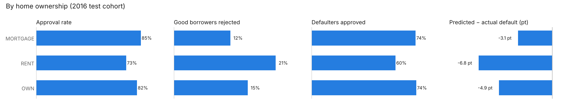
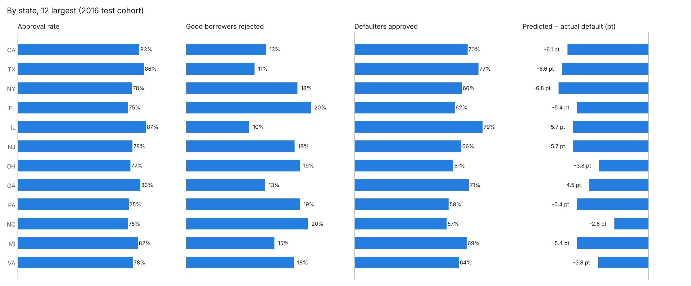

# Fairness check: home ownership and state

**Question:** does the champion model (tuned gradient boosting, approve the safest 80%) approve
and make mistakes at different rates for different groups of applicants?

**Setup:** the model is trained on 2007–2015 loans, the cutoff is set on that period
(approve if predicted default probability ≤ 0.257), and the 50,000 unseen 2016 loans are scored.
Groups with fewer than 500 loans are left out. Reproduce with `scripts/fairness_analysis.py`;
the full tables are in [fairness_tables.md](fairness_tables.md).

Metrics per group:

- **Approval rate** and **approval ratio** (approval rate ÷ highest group's). Below 0.80 would fail the "four-fifths rule" used in US fair-lending reviews.
- **Good borrowers rejected** (false rejection rate): share of loans that were repaid but would have been rejected.
- **Defaulters approved** (missed default rate): share of defaults the policy lets through.
- **Calibration gap:** mean predicted probability minus actual default rate.

## Home ownership

| Group | Loans | Actual default | Approval | Ratio | Good borrowers rejected | Defaulters approved |
|---|---|---|---|---|---|---|
| Mortgage | 24,271 | 19.8% | 85.4% | 1.00 | 11.8% | 73.8% |
| Rent | 19,648 | 27.7% | 73.5% | 0.86 | 21.2% | 59.5% |
| Own | 6,076 | 23.1% | 82.2% | 0.96 | 15.4% | 74.3% |

- Renters are approved less often (73.5% vs 85.4%), but their actual default rate is also much
  higher (27.7% vs 19.8%), so most of the gap reflects real risk. The approval ratio is 0.86,
  above the 0.80 threshold.
- The cost of errors is not shared equally: a renter who would repay is rejected **21%** of the
  time, almost twice as often as a homeowner with a mortgage (12%). Renters who default are more
  often caught (60% approved vs 74%), so the model trades more false rejections for fewer missed
  defaults in this group.
- The model under-predicts risk for every group, most for renters (−6.8 points vs −3.1 for
  mortgage holders). This is the calibration problem already seen in INSY 674 on the 2016 cohort.

## State (12 largest)

- Approval rates range from 74.8% (NC) to 87.2% (IL); the lowest ratio is 0.86 (NC, FL), above 0.80.
- Good-borrower rejections range from 10% (IL) to 20–21% (FL, NC). Florida also has a higher
  actual default rate (25.6%), but North Carolina does not (22.3%, below average): NC applicants
  look riskier on the inputs (FICO, DTI, income) than their outcomes turned out to be.
- State enters the model only through a smoothed target encoding (state default rate pulled toward
  the overall rate), so its direct effect is small; most differences come from the applicant mix.

## What we conclude and would do next

- No group falls below the four-fifths rule, and the approval gaps mostly follow real differences
  in default rates. Error rates are less even: renters and applicants in some states carry about
  twice the false-rejection rate of the best-treated group.
- Home ownership and state are legitimate credit inputs here, but they can act as proxies for
  protected attributes (income, age, race through geography), which this dataset does not contain,
  so this check cannot rule out disparate impact on protected groups.
- Next steps: recalibrate on recent data (the under-prediction is largest for renters), add these
  group metrics to the Evidently monitor so a growing gap triggers an alert, and test whether
  dropping `addr_state` changes accuracy (if not, removing it reduces proxy risk).
